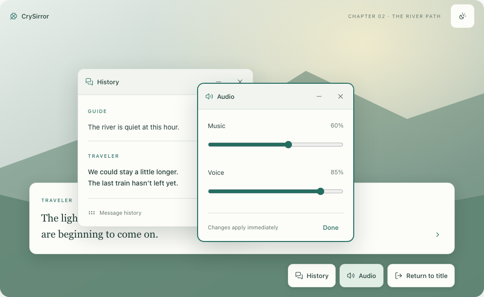
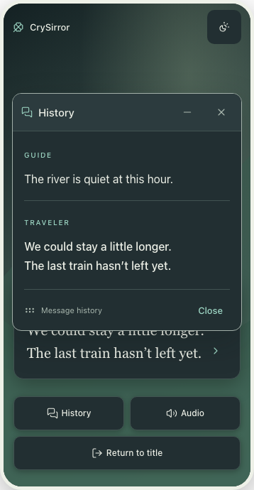
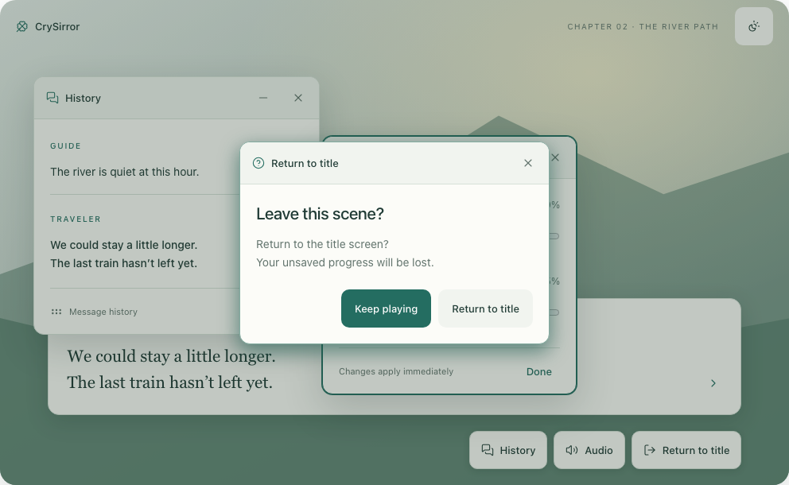

# In-game child windows

Design draft, 2026-11-16. This defines proposed appearance and interaction,
not implemented engine support, a new public API or device acceptance.

[Interactive design](in-game-windows.html) ·
[Editable fragment](in-game-windows.fragment.html)

## Implemented style (engine chrome)

Engine-drawn dialogs and menus (`crysirror-scene` `ui::dialog`, `ui::menu`)
use `crates/crysirror-scene/style/ui.css`: CSS custom properties under
`:root` and `@media (prefers-color-scheme: dark)`. `build.rs` compiles them to
the const `LIGHT`/`DARK` tables in `ui::theme`, so no stylesheet is parsed or
retained at run time. The desktop host follows the window theme
(`WindowEvent::ThemeChanged`). Panels are low-contrast neutral greys with a
hairline border, soft shadow and rounded corners (banded solid fills, no
anti-aliasing); focus uses one muted accent. Tooltip colours stay per-request
(`TooltipSpec`). The child-window behaviour below is still a draft.

## Purpose and presentation

Games can request message boxes, auxiliary panels and separate child windows.
Represent their content and native behavior as owned logical windows. A host
can present a compatible request as a native OS window or as a window composed
inside the game view. Mobile hosts must not require desktop-style OS windows.
This does not replace a game's authored message window, buttons or artwork with
a generic settings screen.

The shared in-game presentation is the proposed baseline across desktop, touch
and handheld hosts. Optional native desktop presentation is a separate host
choice with the same logical request/result contract. Arbitrary Win32 controls,
plugin HWNDs or unknown native window APIs are not automatically supported.
Map only reviewed engine requests and keep unsupported semantics explicit.

## Window types

| Type | Interaction | Completion |
| --- | --- | --- |
| Ordinary child window | Drag, focus, raise, collapse and close; other eligible game controls remain available | Native close/result policy; opening does not block the whole game by default. |
| Modal dialog | Can move by its title bar; only its owner's modal scope accepts input until resolved | Retain the original pending call; commit its typed result once. |
| Platform-owned request | File chooser, IME or other genuinely platform-specific interaction | Actual host capability and permission/result handling; no fake success from a drawn imitation. |

Modal scope comes from original semantics: application/client modal and
owner-window modal are different policies. Waiting for a dialog does not by
itself stop all animation, audio, clocks or unrelated clients. Closing the
chrome maps to the reviewed cancel/close behavior; it does not invent a new
result. Escape and default confirmation follow the same rule.

## Visual system

Use compact opaque surfaces, a quiet title strip, a restrained teal accent and
an obvious active-window outline. Inactive windows retain readable content
without competing with the active one. Light/dark appearances share geometry.
The preview's landscape and dialogue are self-authored placeholders.

| Element | Design target |
| --- | --- |
| Title bar | Approximately 52–56 px high, with a generous drag region and distinct chrome controls. |
| Actions | At least 44 px effective targets on desktop; 48 px for touch controls, separated to avoid accidental close. |
| Body | 16–20 px padding; 14 px desktop text and approximately 16 px touch text. Editable touch text remains at least 16 px. |
| Geometry | Moderate corners, subtle border/shadow and 8 px spacing rhythm; no background blur requirement. |
| State | Active/inactive, focused, hovered, pressed, dragged, collapsed, disabled, pending and error are distinct. |
| Skin | Native game assets/styles may supply the visual layer while shared window ownership/input remains consistent. |

## Dragging, coordinates and containment

- Drag only from the title region. Clicking close/collapse or interacting with
  the body must not start a move. Mouse and touch use the same capture model.
- Raise an ordinary window when it is selected, preserving relative order of
  the other windows. Modal overlays remain above their blocked scope.
- In-game windows stay within the usable view, keeping title and close controls
  reachable. Do not let a pointer cancellation leave capture or dragging stuck.
- Keep the game's original canvas and a child's logical client coordinates
  separate from presentation positions. Convert input through the actual
  transforms, without changing native script resolution or returning fabricated
  OS coordinates/handles.
- Preserve position across temporary focus changes. On resize/orientation/
  safe-area/keyboard changes, revalidate against the new usable rectangle;
  returning to a larger view must not strand a window offscreen.
- Window state is client/session scoped. Parent close, game switch and shutdown
  retire its children, pending input and late results in defined order.

## Device adaptations

| Context | Presentation |
| --- | --- |
| Desktop | Floating title-bar windows with clear front/back order. Keyboard and pointer access are equivalent. Optional native OS presentation remains a host decision. |
| Phone portrait | Floating windows fit the available width with safe insets; title dragging remains available. Confirmation actions stack vertically with 48 px touch targets. |
| Phone landscape | Preserve readable content and touch targets while using the wider view; recompute positions instead of scaling the whole desktop UI down. |
| Handheld | Keep strong focus indication and explicit confirm/back navigation; title-bar movement is keyboard/controller accessible without requiring touch. |

If real window content exceeds the usable height, constrain its body with a
scrollable region while retaining the title and action area. A larger/full-view
mode may be offered where the native interaction permits it, rather than
shrinking all text. Those oversized-content and soft-keyboard states are
specified here but not demonstrated by the current short-content preview.

## Input and accessibility

Use native focusable controls. The title drag control supports arrow-key motion;
the preview also supports Shift+arrow for a larger step. Keep focus visible,
restore it after close and confine it to the active modal scope. Enter/Space and
Escape preserve the requested default/cancel semantics. Do not steal unrelated
game keys or deliver the same press to both a window and the scene behind it.

Touch dragging captures only the title region, leaving body selection/scrolling
available. Lost focus, pointer cancellation and suspension must release capture
consistently. IME/soft-keyboard placement and accessible labels belong to the
host/window contract; a simulated text box is not a complete IME integration.

## Implementation handoff and evidence

Reuse shared retained UI, client ownership, input routing, native continuations
and the existing host seam. Inspect actual native request APIs first. Any new
window/command model needs [API compatibility review](../api/README.md#compatibility-assessment),
including existing menu/dialog behavior and serialized state. The `adopt` and
`integrated` boundaries remain unchanged.

The editable preview demonstrates title dragging, front/back selection,
collapse/close, modeless scene interaction, modal input isolation, result/cancel,
light/dark appearance and narrow-layout containment. It is a browser design
prototype, not a CrySirror runtime or native-device test. Full native-window
bridging, oversized bodies, physical controllers, IME, suspend/resume and save
reconstruction remain future implementation/validation work.

## Design plates

### Desktop child windows

### Touch layout

### Modal confirmation

